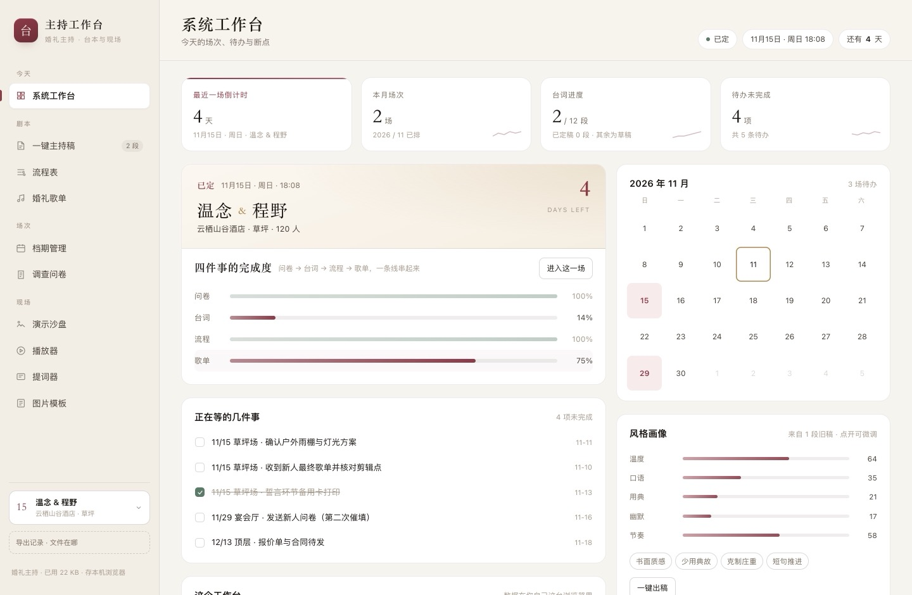
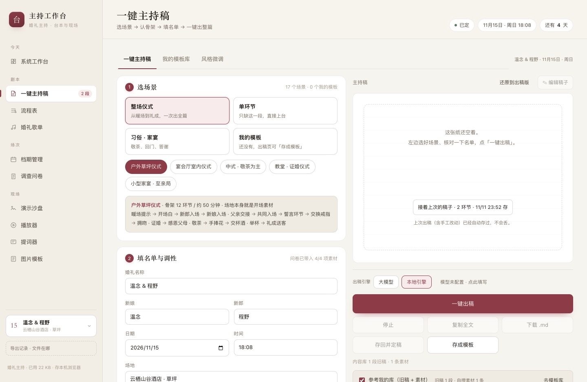
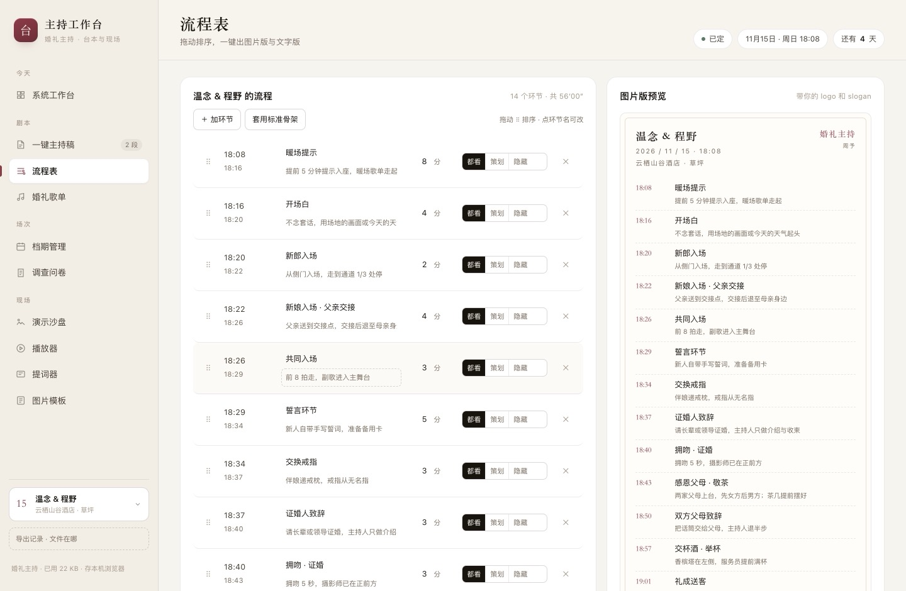
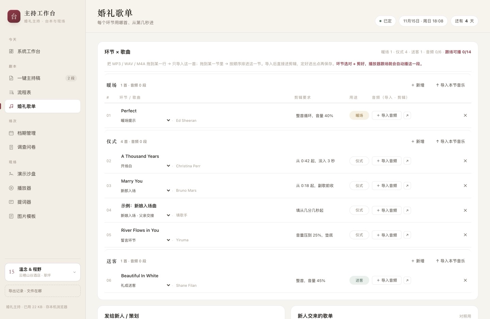
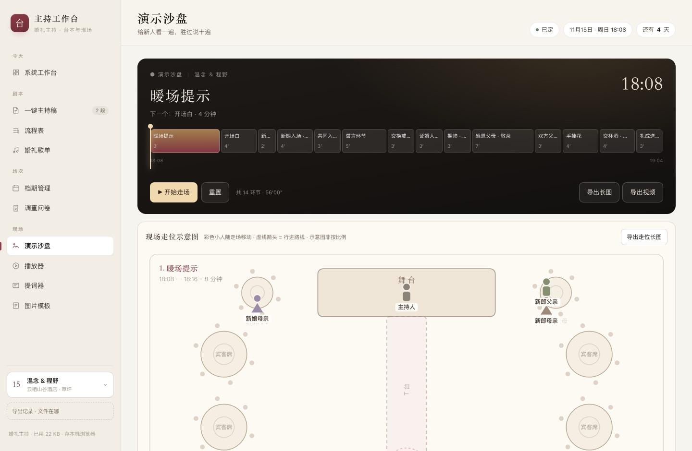

# 婚礼主持工作台 · 可改造版

[](https://maker-west.github.io/wedding-host-starter/)
[](LICENSE)
[](#30-秒跑起来)

一个纯静态的婚礼主持工作台：问卷 → 台词 → 流程 → 歌单 → 现场，10 个页面在同一个 index.html 里跑完。
不需要服务器、不需要数据库、不需要登录，双击就能用。

**在线体验**：https://maker-west.github.io/wedding-host-starter/
**免费拿去改**：品牌、配色、环节表全在 `config.js` 一个文件里，改完刷新就生效。



| 一键主持稿 | 流程表 |
|---|---|
|  |  |
| **婚礼歌单** | **演示沙盘** |
|  |  |

**这份代码是给你改成自己的。** 品牌、配色、14 个环节、9 个角色全部集中在 `config.js` 一个文件里，
改完刷新就生效。具体怎么改看 [改造指南.md](改造指南.md)。

---

## 不想碰代码：直接拿来用

| 方式 | 适合谁 | 怎么做 |
|---|---|---|
| **在线用** | 先看看顺不顺手 | 打开 https://maker-west.github.io/wedding-host-starter/ ，不用装任何东西 |
| **下载单文件** | 想存在自己电脑上、断网也能用 | 下载 [single-file v1.0.0](https://github.com/maker-west/wedding-host-starter/releases/download/v1.0.0/wedding-host-starter-v1.0.0.html)（449 KB），双击打开 |
| **下载源码** | 想改成自己的 | `git clone` 本仓库，然后往下看 |

数据全部存在你自己的浏览器里，不上传、不联网也能用。

---

## 30 秒跑起来

```bash
# 方式一：直接双击
open index.html          # macOS
start index.html         # Windows
xdg-open index.html      # Linux
```

```bash
# 方式二：起个本地服务（改了文件自动生效，推荐边改边看）
python3 -m http.server 8080
# 然后打开 http://127.0.0.1:8080
```

第一次打开会问「看演示 / 从空白开始」。选演示，会有 4 场虚构婚礼，随便改随便删。

---

## 能干什么

| 页面 | 做什么 |
|---|---|
| 系统工作台 | 今天有什么场、待办、四件事的完成度、最近改到哪 |
| 一键主持稿 | 填新人信息 → 出稿；可接自己的大模型，也可用本地规则引擎 |
| 流程表 | 14 个环节、时长自动累加算出几点开始，可拖动排序 |
| 婚礼歌单 | 按环节配歌，标剪辑点，能导出 txt 给酒店音响 |
| 档期管理 | 月历 + 场次详情，一眼看出哪天空着 |
| 调查问卷 | 生成链接和二维码发新人，收回来的答案直接汇总成表 |
| 演示沙盘 | 时间轴播放，模拟整场节奏 |
| 播放器 | 按环节自动切歌，带淡入淡出 |
| 提词器 | 大字号滚动，手机可以当遥控器 |
| 图片模板 | 把流程导出成图片发群里 |

---

## 要改的东西在哪

全部在 `config.js`。改这三段就够用：

```js
/* 1. 品牌 */
brand: {
  name: '主持工作台',        // 侧栏大标题
  seal: '台',                // 左上角方块里的那个字
  tagline: '婚礼主持 · 台本与现场',
  title: '主持工作台 · 婚礼', // 浏览器标签
  backupName: '工作台备份'    // 导出的 json 文件名
},

/* 2. 主色：改这一个值，页面 + 导出的长图 + 走位图一起变 */
theme: { wine: '#8C3B47', /* ... */ },

/* 3. 环节表：加减环节、改名字、改时长 */
segments: [
  { key: 'warm', name: '暖场提示', dur: 8 },
  /* ... */
]
```

**改 `id` 要小心**：它是数据空间的钥匙（`id: 'demo'` → localStorage 键 `wb.demo.*`）。
改了等于换一个全新的库，原来那 4 场演示数据就看不到了。想保留数据就别动它。

---

## 文件都管什么

| 文件 | 行数 | 管什么 |
|---|---|---|
| `config.js` | 170 | **品牌 / 色板 / 环节表 / 走位角色**，唯一需要改的地方 |
| `index.html` | 125 | 页面骨架，脚本加载顺序也在这里 |
| `styles.css` | 960 | 全部样式，色值都走 CSS 变量 |
| `app.js` | 5600 | 应用层：10 个视图、表单、编辑、导出、问卷 |
| `engine.js` | 456 | 本地台词引擎：没有大模型时也能出稿 |
| `stylepacks.js` | 195 | 三档风格：维度预设、6 条硬规则、禁用词、句库 |
| `plan.js` | 450 | 走位图：舞台坐标、9 个角色、按环节插值、导出长图 |
| `seed.js` | 197 | 演示数据：4 场虚构婚礼 + 流程 + 歌单 |
| `llm.js` | 320 | 大模型接入：自己填 key，直连 `/chat/completions` |
| `qr.js` | 300 | 二维码编码器，纯 JS，问卷链接用 |
| `audio.js` | 260 | 音频库，文件存 IndexedDB |
| `importers.js` | 220 | 从文本/表格导入场次 |

---

## 关于语料：这部分是空的，得你自己填

代码和结构是完整的，但**内容刻意留白了**，因为这些是抄不走的：

| 位置 | 现在是什么 | 你要做什么 |
|---|---|---|
| `stylepacks.js` | 每档只有 open / end 两段完整示范，其余 4 个环节是 `〔写一句…〕` 提示 | 填 24 处，写出你自己的句子 |
| `seed.js` 的 `samples` | 一条占位示例 | 粘 2—5 段你过去写过的主持词，用来算风格画像 |
| `seed.js` 的 `materials` | 一条占位示例 | 攒你自己的金句、故事细节 |

出稿时如果看到 `〔写一句父亲的画面…〕` 这种方括号，就是提示你这里还没填。
填完之后，这套东西才开始像「你的」而不是「一个通用的」。

---

## 数据在哪

全部在浏览器本机，不上传、不联网也能用。

- 主体数据：`localStorage['wb.demo.hostdesk.v1']`
- 大模型 key：`localStorage['wb.demo.llm.v1']`（不进导出备份）
- 音频文件：IndexedDB `wb_demo_audio`

换电脑用「关于 → 导出备份」，得到一个 json，在新机器导入。清浏览器数据会全部丢失，重要场次记得导。

---

## 打包成一个文件

改完之后，把 css 和 js 全部内联成单个 html，发给搭档或存到手机里：

```bash
python3 tools/build_single.py
# 产出：工作台.html（约 450 KB，双击即用，不需要任何依赖）
```

---

## 跑测试（可选）

测试依赖 `puppeteer-core` 和本机装好的 Chrome。应用本身零依赖，测试才需要装：

```bash
npm i          # 只装测试用
npm run check    # 语法
npm run smoke    # 10 个视图渲染 + 出稿 + 导出落盘
npm run plan     # 走位图
npm run pack     # 风格档
npm run edit     # 出稿后编辑
npm run share    # 分享与脱敏
npm run llm      # 大模型接入
```

改完 `config.js` 之后建议至少跑一次 `npm run check && npm run smoke`。

---

## 授权

免费给同行用：可以自己用、可以改、可以给团队用、可以发给别的主持人、可以 Fork 提 PR。

不能拿去卖、不能做成付费课程或素材包、不能部署成收费服务、不能去掉署名当自己原创。

详见 [LICENSE](LICENSE)。简单说：**拿去改、拿去用，别拿去卖。**

---

## 已知的边界

- 没有云端、没有账号。多设备同步靠导出 json 手动搬。
- 问卷是「生成链接/二维码 → 新人填 → 复制回答发回你」，没有服务端收集。
- 大模型要自己准备 key。不填也能用，走本地规则引擎，稿子会朴素一些。
- 走位图是示意图，不按场地真实比例，标注了也不能当施工图用。
